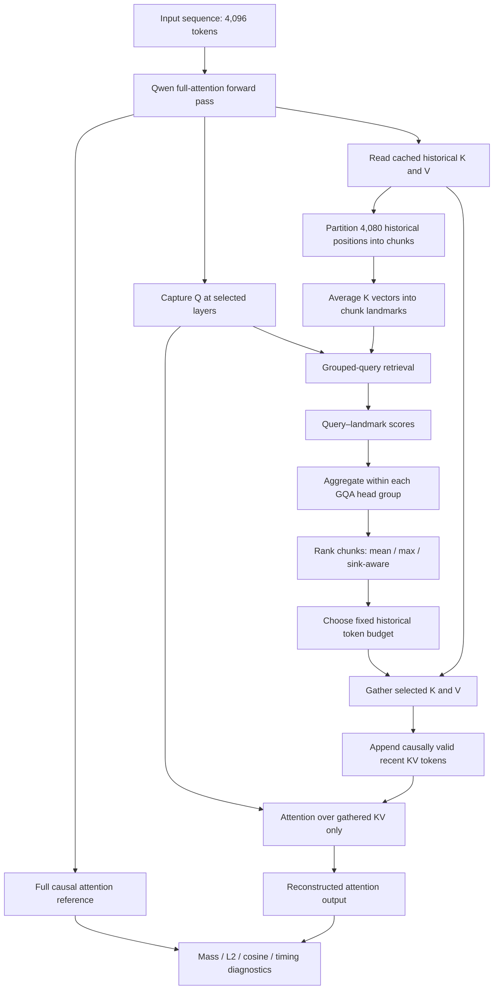
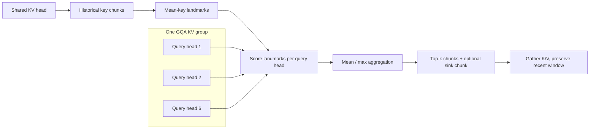

# ShadowKV Reproduction & GQA-Aware KV-Cache Retrieval

**Independent research investigation · Zaid Aljerme · Electrical & Computer Engineering, Oregon State University**

An experimental study of **chunk-based key–value (KV) cache retrieval for grouped-query attention (GQA)** in transformer language models. Inspired by [ShadowKV](https://arxiv.org/search/?query=ShadowKV&searchtype=all), this project reproduces and extends selected *mechanisms* behind landmark-based retrieval, compares chunk-ranking methods under controlled token budgets, and studies the gap between **attention fidelity** and **GPU execution efficiency**.

> **Project status — research prototype.** The experiments currently measure offline attention-output reconstruction from hidden states produced by full-attention Qwen models. A gather-based sparse-attention calculation has passed numerical checks against an equivalent masked reference. The project **does not yet provide end-to-end sparse decoding, measured KV-cache memory savings, or faster language-model generation**. This is an independent mechanism-level investigation, not a verified reproduction of the complete original ShadowKV inference system.

## At a glance

| Scope | Details |
|---|---|
| Models tested | `Qwen/Qwen2.5-0.5B`, `Qwen/Qwen2.5-1.5B` |
| Attention type | Grouped-query attention (GQA) |
| Data | WikiText-2 raw validation; disjoint 4,096-token windows |
| Layers examined | 0, 3, 8, 22 |
| Default context | 4,096 tokens: 4,080 historical + 16 recent-query positions |
| Retrieval unit | Contiguous historical KV chunks; sizes 4, 8, or 16 |
| Historical budget | 64, 128, 256, or 512 tokens **per KV head and query** |
| Evaluation | Retained causal attention mass, attention-output relative L2 error, cosine similarity, oracle overlap |
| GPU | NVIDIA Quadro RTX 8000 (46,080 MiB reported VRAM) |
| Status | Offline fidelity experiments and preliminary PyTorch GPU timings completed |

## Research questions

1. How does pooling the query heads that share a KV head affect landmark-based chunk selection?
2. How much does explicitly retaining the initial **attention-sink chunk** change reconstruction fidelity?
3. Do layer-specific retrieval rules transfer between model sizes?
4. At a constant retrieved-token budget, how does chunk size affect fidelity?
5. Does a correct gather-based sparse-attention implementation actually run faster once selection overhead is included?

## System overview



**Two distinct paths are intentional:** the full-attention forward pass provides the reference activations and true attention scores for *evaluation*; the selected-KV path computes a reconstructed output over a smaller set. The full pass remains present in the offline experiment, so this diagram does not imply end-to-end sparse inference.

### GQA and chunk selection

For Qwen2.5-1.5B, 12 query heads share 2 KV heads, giving **6 query heads per KV head**. The landmark ranker first partitions each KV head's 4,080 historical positions into chunks. The mean of a chunk's key vectors becomes a landmark. Query–landmark scores are softmax-normalized, then averaged or maximized across the query heads associated with the same KV head.



A default 256-token historical budget with chunk size 8 means selecting **32 historical chunks** per KV head/query. Under sink protection, historical chunk 0 is always selected and the remaining 31 slots go to the highest-ranked other chunks.

## Methods and evaluation

| Method | Historical chunk selection |
|---|---|
| `mean` | Average landmark probability over the query heads sharing a KV head; top-k chunks |
| `max_sink` | Maximum across grouped query heads; force chunk 0 into the fixed budget |
| `mean_sink` | Mean across grouped query heads; force chunk 0 into the fixed budget |
| `layer_aware` | Mean ranking, with forced chunk 0 only at specified layers (model-calibrated variant below) |
| `oracle` | Select top chunks using **exact reference attention mass**; an inaccessible-at-inference diagnostic upper baseline for mass, **not** an output-error-optimal oracle |

For each of the last 16 query positions, the reference is full **causal** attention over the available prefix. Reconstruction uses exactly the configured historical token budget plus all causally visible positions from the recent 16-token window. The experiment compares output vectors (before subsequent attention output projection), not final model tokens.

**Metric definitions:**

- **Mass retained ↑:** summed probability from the reference attention distribution over retained positions.
- **Relative L2 ↓:** `||o_sparse - o_full||₂ / max(||o_full||₂, ε)` per query head, aggregated in the benchmark.
- **Cosine similarity ↑:** cosine between reconstructed and full attention outputs.
- **Chunk recall ↑:** fraction of attention-mass oracle chunks also selected by `mean_sink`; this metric is *partition-specific*, so recall across different chunk sizes is not directly comparable.

## Experimental results

All results below are from the user's completed experiments. Unless stated otherwise, the protocol is: **4,096-token context, last 16 query positions, four selected layers, float32 attention analysis**, and 10 validation windows. Values are averages reported by the benchmark. The initial 0.5B experiments and some later runs differed in tokenization/windowing details, so cross-run numerical comparisons should be interpreted cautiously.

### 1. Full-causal attention reconstruction at 256 historical tokens

| Method | Qwen2.5-0.5B relative L2 ↓ | Qwen2.5-1.5B development relative L2 ↓ | Qwen2.5-1.5B held-out relative L2 ↓ |
|---|---:|---:|---:|
| `mean` | 0.5820 | 0.7909 | 0.7332 |
| `max_sink` | 0.2392 | 0.1247 | 0.1278 |
| `mean_sink` | 0.2359 | 0.1229 | 0.1260 |
| `layer_aware` | 0.2354 | 0.3522 | 0.1257 |
| `oracle` | 0.2046 | 0.1071 | 0.1103 |

**Note about `layer_aware`:** the first two columns use the original policy protecting layers **3 and 8**; the held-out 1.5B column uses a **calibrated policy protecting layers 3, 8, and 22** selected on the development windows. This row therefore represents different policies and is *not* a like-for-like comparison across all columns.

On the held-out Qwen2.5-1.5B windows, protecting chunk 0 reduced mean-ranking relative L2 from **0.7332 to 0.1260** (about **82.8%**). This highlights the importance of a **known attention-sink technique** in the tested setting; sink protection itself is not claimed as novel.

### 2. Layer behavior varies with model size

For Qwen2.5-1.5B development windows at budget 256, chunk size 8:

| Layer | `mean` L2 ↓ | `mean_sink` L2 ↓ | Difference |
|---|---:|---:|---:|
| 0 | 0.0576 | 0.0583 | -0.0007 |
| 3 | 1.2305 | 0.1435 | +1.0870 |
| 8 | 0.8165 | 0.1486 | +0.6678 |
| 22 | 1.0591 | 0.1412 | +0.9179 |

The initial 0.5B-specific rule (protect layers 3 and 8) failed to transfer cleanly because layer 22 benefited strongly from sink protection in the 1.5B model. A calibrated 1.5B rule achieved **0.1257** relative L2 on later windows versus **0.1260** for global `mean_sink`: a tiny difference, without an established practical benefit.

### 3. Historical retrieval budget sweep — Qwen2.5-1.5B held-out

Chunk size **8**, 10 held-out windows; historical token budget held equal for every method at each setting.

| Historical token budget | `mean` L2 ↓ | `mean_sink` L2 ↓ | `oracle` L2 ↓ | Fraction of historical positions selected |
|---|---:|---:|---:|---:|
| 64 | 1.2351 | 0.2346 | 0.2100 | 1.57% |
| 128 | 0.9894 | 0.1746 | 0.1546 | 3.14% |
| 256 | 0.7332 | 0.1260 | 0.1103 | 6.27% |
| 512 | 0.4481 | 0.0853 | 0.0732 | 12.55% |

The percentages describe positions *selected from the historical context*; they are **not observed GPU memory reductions** and exclude the recent window.

### 4. Chunk size sweep — same 256-token historical budget

Qwen2.5-1.5B held-out windows. The number of selected tokens is held constant; changing chunk size changes the number of landmarks scored.

| Chunk size | Historical landmarks scored | Chunks selected | `mean_sink` mass ↑ | `mean_sink` L2 ↓ | `oracle` L2 ↓ |
|---|---:|---:|---:|---:|---:|
| **4** | 1,020 | 64 | **0.8839** | **0.1119** | **0.0996** |
| 8 | 510 | 32 | 0.8722 | 0.1260 | 0.1103 |
| 16 | 255 | 16 | 0.8626 | 0.1389 | 0.1219 |

At fixed budget, chunk size 4 reduced `mean_sink` relative L2 by approximately **11.2% versus size 8**, but required scoring twice as many landmarks. The oracle also improved with smaller chunks, so the gains cannot be attributed entirely to better landmark ranking.

### 5. Chunk-ranking diagnostics

At size 8, budget 256, the experiment compared `mean_sink` selections against attention-mass-oracle selections. Mean over the 10 evaluated passages (rounded):

| Layer | Approximate oracle chunk recall ↑ | Approximate oracle-selected mass missed ↓ |
|---|---:|---:|
| 0 | 66% | 14% |
| 3 | 80% | 3% |
| 8 | 69% | 5% |
| 22 | 76% | 4% |

Missing many oracle chunks does not always mean losing much important attention. Layer 0 showed the largest fraction of missed mass among oracle-selected historical chunks in this diagnostic. The missed-mass fraction is **not** the fraction of all causal attention lost.

### 6. Preliminary GPU efficiency: no speedup yet

Using Qwen2.5-1.5B on a **Quadro RTX 8000**, 4K context, chunk size 8, 256 historical tokens, the custom PyTorch timing script reported approximately:

| Measured component | Typical time |
|---|---:|
| Full causal attention, straightforward matmul implementation | ~0.34 ms |
| Query-to-landmark scoring and softmax | ~0.063 ms |
| Top-k selection **with validation assertions** | ~0.229 ms |
| Historical K/V gather | ~0.067 ms |
| Gathered sparse-attention arithmetic | ~0.379 ms |
| **Preliminary summed sparse stages** | **~0.74 ms** |
| **Full / preliminary sparse ratio** | **~0.46×** |

The preliminary sparse stages were therefore roughly **2.2× slower** than this full-attention implementation. These are **not** end-to-end generation times. The sum omits landmark construction, head aggregation, index preparation, and sparse-tensor assembly; top-k includes GPU-synchronizing validations; the comparator is not optimized FlashAttention. The experiment currently demonstrates **performance bottlenecks, not an acceleration**. Also, the output CSV stores fidelity metrics, while the latency values above were printed in the terminal and should be captured in structured form in a future benchmark.

## Repository layout

Paths shown here correspond to scripts and artifacts used during the investigation. Not all files are bundled with this README; check the repository before following a particular command.

```text
shadowkv-reproduction/
├── README.md
├── models/
│   └── toy_attention.py                 # RoPE / attention utilities
├── experiments/
│   ├── gqa_aggregation_benchmark.py
│   ├── gqa_aggregation_real.py
│   ├── gqa_long_context.py
│   ├── gqa_attention_fidelity.py
│   ├── gqa_full_causal_fidelity.py
│   ├── gqa_qwen_1p5b_fidelity.py
│   ├── gqa_qwen_1p5b_heldout.py
│   ├── gqa_budget_sweep.py
│   ├── gqa_chunk_diagnostic.py
│   ├── gqa_chunk_size.py
│   ├── gqa_efficiency.py
│   └── gqa_gpu_timing.py
├── results/
│   └── csv/
│       ├── gqa_qwen_1p5b_fidelity_4k.csv
│       ├── gqa_qwen_1p5b_heldout.csv
│       ├── gqa_budget_sweep_64.csv      # ...128, 256, 512
│       ├── gqa_chunk_size_4.csv        # ...8, 16
│       └── gqa_gpu_timing_8.csv
└── tests/                               # 50 tests reported passing
```

## Reproducing the experiments

**Environment used:** Python 3.12, PyTorch 2.6 with CUDA 12.6 in the research environment, Hugging Face Transformers and Datasets, Pandas; Slurm-allocated NVIDIA GPU. GPU drivers and other package versions may differ elsewhere. Use an isolated Python environment and install the required dependencies appropriate for your CUDA setup.

Commands below are executed **from the project root on a GPU compute node**, not an HPC login node:

```bash
export OMP_NUM_THREADS=2
export MKL_NUM_THREADS=2
export OPENBLAS_NUM_THREADS=2

# Held-out evaluation on Qwen2.5-1.5B
python -m experiments.gqa_qwen_1p5b_heldout

# Retrieval budget sweep
for budget in 64 128 256 512; do
    KV_BUDGET="$budget" python -m experiments.gqa_budget_sweep
done

# Chunk size sweep at a 256-token historical budget
for chunk in 4 8 16; do
    KV_CHUNK="$chunk" KV_BUDGET=256 python -m experiments.gqa_chunk_size
done

# Gathered-sparse correctness comparison
KV_CHUNK=8 KV_BUDGET=256 python -m experiments.gqa_efficiency

# Preliminary GPU timing (currently diagnostic, not optimized)
KV_CHUNK=8 KV_BUDGET=256 python -m experiments.gqa_gpu_timing
```

The held-out script starts at passage window index **10**, while the earlier development script used the first ten disjoint windows. Experiment scripts save CSV output and adjacent JSON metadata. Results may vary with software versions, GPU, dtype, and dataset/tokenizer revisions.

### Data and implementation notes

- The historical context is 4,080 positions, followed by a 16-token recent window.
- Query positions use the same RoPE conventions as the model, with query capture from selected transformer layers.
- The benchmark evaluates an **offline approximation** to selected attention outputs; the model hidden states are not generated with the sparse policy in place.
- The sparse implementation gathers K and V for each KV group/query, expands GQA groups, appends the recent positions, applies their causal mask, and computes a softmax-weighted value sum.
- A correctness assertion compared this output against the same selected attention represented as a mask over a full attention-score matrix; the default chunk-size-8 configuration completed without triggering that assertion.
- The attention-mass oracle uses exact reference probabilities and is a **diagnostic**, not a deployable inference-time method.

## Current limitations and next research directions

**Established by this prototype:** sink-aware chunk selection substantially improves offline output reconstruction; smaller chunks improve fidelity at the tested fixed budget; and a naïve PyTorch sparse implementation can be slower despite selecting fewer historical tokens.

**Not yet established:** performance gains over optimized attention kernels, substantial GPU cache-memory reductions, generation-quality retention under actual sparse decoding, cross-family model generalization, statistically robust improvements from layer calibration, or a novel ranking algorithm beyond published baselines.

Next steps:

1. **Benchmark correctly:** remove validation synchronization from timed kernels, record per-stage timing/peak allocations in CSV, and account for all preparation overhead.
2. **Optimize sparse attention:** evaluate batched matmul/SDPA and efficient gather/indexing; compare with appropriate optimized full-attention baselines.
3. **Test actual decoding:** integrate selected historical K/V into autoregressive inference without running full-attention hidden states as a crutch; measure token quality, throughput, and allocated memory.
4. **Investigate landmark-ranking failures:** study per-layer missed attention mass, alternative landmark summaries, and quality–latency tradeoffs.
5. **Broaden evaluation:** test different datasets, contexts, model families, repeated seeds, and stronger published baselines.

## Research motivation

My broader interest is **efficient machine learning systems at the intersection of algorithms, hardware, and GPU implementation**. This project began as a mechanism-level reproduction inspired by ShadowKV and evolved into a controlled experimental investigation: after finding that landmark selection could reconstruct attention reasonably well, I tested whether those accuracy results translated into an efficient implementation. The first timing results revealed the opposite—selection and kernel overhead outweighed the savings—motivating a closer study of algorithm–hardware co-design for efficient LLM inference.

I am sharing this work as an **ongoing undergraduate research exploration** and welcome technical feedback, collaboration, and guidance on the next experimental steps.

## Acknowledgments and references

- **ShadowKV** — the prior work motivating the investigation; the original authors retain credit for the underlying ideas. [Find the paper on arXiv](https://arxiv.org/search/?query=ShadowKV&searchtype=all).
- **Qwen2.5** — open-weight language models used in the experiments. [Qwen2.5-0.5B](https://huggingface.co/Qwen/Qwen2.5-0.5B) · [Qwen2.5-1.5B](https://huggingface.co/Qwen/Qwen2.5-1.5B).
- **WikiText-2** — validation text used for evaluation. [Dataset](https://huggingface.co/datasets/Salesforce/wikitext).

---

*This README summarizes the code and experimental logs available during preparation; review script paths, environment details, and source citations against the public repository before publishing.*
